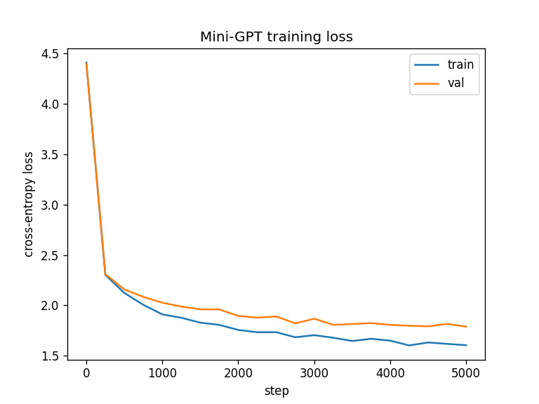

# mini-gpt: a decoder-only GPT written from scratch in PyTorch
[](https://msrit.ask.thili.ai/b/23snjh3qpz)
A small GPT (the architecture behind GPT-2 and Llama) built layer by layer:
character tokenizer, token + position embeddings, hand-written masked
self-attention, transformer blocks, training loop, and sampling. No
`nn.MultiheadAttention`, no Hugging Face, no API calls. Trains on a CPU in minutes.


## Pipeline

```
raw text -> char tokenizer -> token + position embeddings
         -> N transformer blocks (causal self-attention + MLP, residual + LayerNorm)
         -> next-token logits -> sample -> generate
```

## Files

| File | Purpose |
|---|---|
| `tokenizer.py` | `CharTokenizer`: encode/decode characters |
| `attention.py` | `Head` and `MultiHeadAttention`: scaled dot-product attention with a causal mask |
| `model.py` | `GPTConfig`, `FeedForward`, `Block`, `GPT` |
| `train.py` | Training loop (AdamW, next-token cross-entropy); saves `gpt.pt`, `loss_log.csv`, `loss_curve.png` |
| `generate.py` | `MiniGPT.complete()` with temperature, top-k and top-p; also a CLI |
| `evaluate.py` | Validation loss, perplexity, baselines and samples; writes `RESULTS.md` |
| `tests/` | pytest suite (tokenizer round trip, causal mask, shapes, initial loss, training step, generation) |
| `.github/workflows/ci.yml` | Runs the tests on every push |

## Reproduce

Python 3.10+; dependencies are pinned in `requirements.txt`.

```bash
pip install -r requirements.txt
mkdir -p data
curl -o data/input.txt https://raw.githubusercontent.com/karpathy/char-rnn/master/data/tinyshakespeare/input.txt
python -m pytest -q                       # tests
python train.py --data data/input.txt --steps 5000
python evaluate.py                        # fills the results below
python generate.py --prompt "ROMEO:" --tokens 300 --temperature 0.8 --top_k 20
```

Data: Tiny Shakespeare (about 1.1 MB of plain text), downloaded by the `curl`
command above. Any UTF-8 `.txt` file works via `--data`.

## Results

Training loss curve (train and validation, evaluated every 250 steps):



<!--RESULTS-->
Corpus: `data/input.txt` (1,115,394 characters, vocab 65); model: 159,937 parameters, context 32, 3 layers x 4 heads, n_embd 64.

| Model | Validation loss (nats/char) | Perplexity |
|---|---|---|
| Uniform guess (ln vocab) | 4.174 | 65.0 |
| Unigram character frequencies | 3.347 | 28.4 |
| **Mini-GPT (this repo)** | **1.802** | **6.1** |

Samples (top-k 20):

Temperature 0.5:
```

Countent the senation this sound he present the father,
And in this with be sound the sent of great brother waster.

POMPEY:
I shall not here not he shall with him with his brother,
I wake my than name his true that is the brother and that with on wi
```

Temperature 0.8:
```

But with this move, for your master:
In this to he have creeter of my big then own eachard.

COMIO:
In him it
I will will will to speak is the die should this find
More news me bound and, for himselves hear own sin
With be is hear. Go hour traitors t
```

Temperature 1.0:
```


Come, diwn, this gave, your cattales friend the wrong intake haste of so cheeknates friends,
I call go, a fingue done, that and by suake so,
To wife be lieve witch be damnight
With bay shall notire fink thy light my tyrant up his come
To that sould 
```
<!--/RESULTS-->

## Limits and baselines

- The baselines are a uniform guess over the vocabulary and a unigram
  model of character frequencies. The GPT beats both, but the table above is the
  honest comparison.
- It is a character-level model with a 32-character context and roughly 0.16M
  parameters, trained for minutes on a CPU. It learns spelling, line breaks,
  speaker-name format and verse shape, but the text is not coherent and words are
  often invented.
- Validation loss is measured on the last 10% of one text, so it says how well
  the model fits this author, not language in general.
- No dropout, learning-rate schedule or weight tying, and only one corpus and seed.
  Better results would need a bigger model, byte-pair tokens and a longer run.

## References
- Vaswani et al., *Attention Is All You Need* (2017)
- Radford et al., *Language Models are Unsupervised Multitask Learners* (2019)
